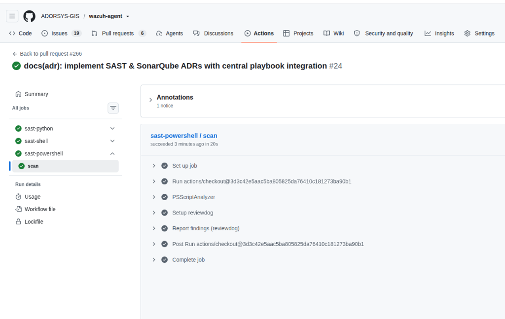

# ADR-0001: Pre-Merge Static Application Security Testing (SAST) Enforcement

> Enforce automated multi-language static application security testing (SAST) via reusable GitHub Actions templates on every pull request, because manual reviews and local-only hooks cannot guarantee auditable baseline security across all platforms.

## Metadata

| Field | Value |
| :--- | :--- |
| **Document ID** | ADR-0001 |
| **Status** | `Accepted` |
| **Date** | 2026-10-20 |
| **Recorded** | 2026-10-20 |
| **Deciders** | SIEM Security Engineering Team |
| **Governs** | `.github/workflows/sast.yml`, `scripts/linux/`, `scripts/macos/`, `scripts/windows/` |
| **Amends** | N/A |
| **Amended by** | N/A |
| **Supersedes** | N/A |
| **Superseded by** | N/A |

## Context

The `wazuh-agent` repository contains critical client-side automation and deployment logic spanning multiple scripting languages:
- **Bash** (`install.sh`, Linux/macOS agent configuration scripts)
- **PowerShell** (`Install.ps1`, Windows enrollment and service setup scripts)
- **Python** (Auxiliary integration and verification tools)

Historically, code quality was validated using scattered local scripts and manual review, leading to inconsistent security postures across platforms. Vulnerabilities such as unquoted variables in shell scripts, insecure command execution in PowerShell, or path traversal flaws could impact endpoint security across the entire infrastructure.

We required an automated, reproducible security verification gate that runs on every pull request, provides immediate inline feedback to contributors, and enforces compliance without hindering developer velocity.

## Decision

We will enforce automated **Static Application Security Testing (SAST)** on all pull requests and pushes to `main` and `develop` by consuming standardized reusable workflows from `ADORSYS-GIS/adorsys-ci-cd-templates`.

The enforcement mechanism operates via `.github/workflows/sast.yml`:
1. **Multi-Language Matrix Scanning**:
   - **ShellCheck** (`sast-shell.yml`): Analyzes `install.sh` and shell utilities.
   - **PSScriptAnalyzer** (`sast-powershell.yml`): Scans `Install.ps1` for PowerShell best practices and security rules.
   - **Bandit** (`sast-python.yml`): Scans all Python utilities for common security weaknesses.
2. **Reviewdog PR Annotations**:
   - SAST findings are surfaced directly on the GitHub Pull Request diff using `reviewdog`.
   - Requires explicit GitHub Actions workflow permissions: `contents: read`, `actions: read`, `checks: write`.
3. **Pre-Merge Quality Gate**:
   - PR checks must pass cleanly before code can be merged into protected branches. High and Critical findings fail the build.

## Options considered

| Option | Verdict | Why (one line) |
| :--- | :--- | :--- |
| Reusable CI workflows via `adorsys-ci-cd-templates` | Adopted | Centralizes scanner configuration, eliminates drift, and provides inline Reviewdog PR annotations. |
| Run scanners locally via pre-commit hooks only | Rejected | Cannot be mechanically enforced; relies on developer discipline; cannot serve as auditable proof for ISO 27001 auditors. |
| Bespoke scanner installation in repository CI | Rejected | Redundant maintenance across 10+ Wazuh repositories; high drift risk. |

## Consequences

**Not part of this decision:** Dynamic Application Security Testing (DAST) or third-party dependency binary scanning.

### Impact

**Benefits**
- Consistent, auditable static security checks across Linux, Windows, and macOS installation scripts.
- Immediate feedback directly on PR diffs via Reviewdog annotations.
- Satisfies ISO 27001 requirements for secure systems development and automated verification.

**Costs**
- PR authors must address scanner warnings before merge.
- Workflow requires `checks: write` permissions for GitHub Actions to post review comments.

**Risks**
- Upstream changes to `adorsys-ci-cd-templates` breaking the workflow; mitigated by pinning reusable workflows.

### Accepted limits

- Pre-merge SAST validates syntax and known semantic security patterns, but does not execute runtime behavioral or penetration testing.

### Done when

- [x] `.github/workflows/sast.yml` configured and active.
- [x] Reviewdog inline annotations verified on PR diffs with `checks: write` permissions.
- [x] Pre-merge checks blocking on High/Critical findings on protected branches.

### Revisit when

- When upstream `adorsys-ci-cd-templates` releases a breaking version change or during annual ISO 27001 audit review.

## Rollback

Nothing to roll back. (In case of transient CI blocking due to template outages, workflow can be temporarily bypassed via administrative bypass or disabling `.github/workflows/sast.yml`).

## Evidence

| Claim | Where |
| :--- | :--- |
| Passing SAST matrix workflow | [`docs/images/workflows/01-github-actions-sast-pass.png`](../images/workflows/01-github-actions-sast-pass.png) |
| PSScriptAnalyzer zero findings | Issue `ADORSYS-GIS/wazuh-agent#260` / PR `ADORSYS-GIS/wazuh-agent#261` |
| Reusable templates repository | `ADORSYS-GIS/adorsys-ci-cd-templates` |

## References

- Workflow Definition: [`.github/workflows/sast.yml`](../../.github/workflows/sast.yml)
- Reusable CI Templates: [ADORSYS-GIS/adorsys-ci-cd-templates](https://github.com/ADORSYS-GIS/adorsys-ci-cd-templates)
- Master Security Specification: [Wazuh SAST Integration Guide](https://github.com/ADORSYS-GIS/wazuh-playbook/blob/main/SOC-Documentation/sast-integration.md)

## Solution implementation

| Kind | Tracking | Status | What it covers |
| :--- | :--- | :--- | :--- |
| Issue | ADORSYS-GIS/wazuh-agent#265 | Open | Audit-readiness: Implement SAST & SonarQube ADRs with Central Playbook Integration |
| PR | ADORSYS-GIS/wazuh-agent#266 | Open | In-repo ADRs, visual evidence, and documentation standard alignment |
