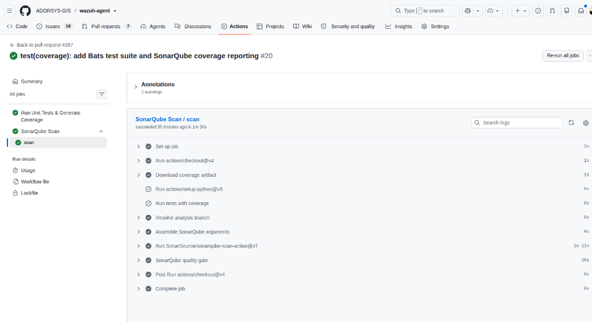

# ADR-0002: SonarQube Centralized Quality Gate & Compliance Standards

> Enforce centralized SonarQube Quality Gate compliance on protected branches via adorsys-ci-cd-templates, because decentralized linters cannot provide continuous cross-branch trend analysis or auditable compliance reporting.

## Metadata

| Field | Value |
| :--- | :--- |
| **Document ID** | ADR-0002 |
| **Status** | `Accepted` |
| **Date** | 2026-10-20 |
| **Recorded** | 2026-10-20 |
| **Deciders** | SIEM Security Engineering Team |
| **Governs** | `.github/workflows/sonarqube.yml`, `sonar-project.properties` |
| **Amends** | N/A |
| **Amended by** | N/A |
| **Supersedes** | N/A |
| **Superseded by** | N/A |

## Context

While pre-merge SAST catches immediate syntax and language-specific security flaws, we need a unified platform to track long-term code quality, identify architectural code smells, enforce security hotspot reviews, and monitor test coverage trends across branches.

For our compliance roadmap (including ISO 27001 / TÜV Hessen certifications), auditors require demonstrable proof of centralized static analysis and quality gate enforcement across releases.

## Decision

We will integrate `wazuh-agent` into our centralized SonarQube instance (configured securely via repository secret `SONAR_HOST_URL`) using the reusable SonarQube workflow from `ADORSYS-GIS/adorsys-ci-cd-templates`.

The enforcement mechanism operates via `.github/workflows/sonarqube.yml`:
1. **Target Triggers & Branches**:
   - Analysis runs on pull requests and pushes targeting `develop` and `main`, as well as manual triggers (`workflow_dispatch`).
2. **Quality Gate Compliance**:
   - The repository must maintain a **Passing Quality Gate** on `main` prior to release tagging.
   - Enforces zero open vulnerabilities, zero open security hotspots, and code smell remediation.
3. **Secret Management & Runners**:
   - Authentication is governed via GitHub Secrets (`SONAR_HOST_URL`, `SONAR_TOKEN`), executing on standard GitHub runners (`ubuntu-22.04` for unit testing and `ubuntu-latest` for scanning).
4. **Scan Scope & Exclusions**:
   - Excludes generated test coverage artifacts (`**/coverage/**`), ensuring all hand-written Shell and PowerShell code remains scanned.
   - Standardized in the centralized [SonarQube Scan Exclusions Guide](https://github.com/ADORSYS-GIS/wazuh-playbook/blob/main/SOC-Documentation/sonarqube-scan-exclusions.md).

## Options considered

| Option | Verdict | Why (one line) |
| :--- | :--- | :--- |
| Centralized SonarQube via `adorsys-ci-cd-templates` | Adopted | Centralized dashboard, historical metrics, and audit-ready ISO 27001 / OWASP compliance mapping. |
| Rely solely on SAST linter checks (Reviewdog) | Rejected | No centralized dashboard, no cross-branch historical tracking, and lacks unified compliance reporting required by external auditors. |

## Consequences

**Not part of this decision:** Test coverage gate percentage enforcement (governed under Master Epic #2190).

### Impact

**Benefits**
- Centralized dashboard providing auditable evidence of code security for external audits.
- Automated quality gate blocks releases if severe vulnerabilities or hotspots are detected.
- Standardized integration shared with other core Wazuh repositories.

**Costs**
- Requires active availability of internal SonarQube server and valid runner secrets.
- Requires ongoing maintenance of project keys and scanner exclusion properties.

**Risks**
- Runner or SonarQube server downtime delaying CI; handled via timeout configurations.

### Accepted limits

- Analysis runs post-merge on protected branches (`develop`, `main`) rather than as a prerequisite check on all external forks.

### Done when

- [x] `.github/workflows/sonarqube.yml` configured and active.
- [x] Runner secrets `SONAR_HOST_URL` and `SONAR_TOKEN` mapped.
- [x] Scans reporting to centralized SonarQube project `wazuh-agent`.

### Revisit when

- Annually during ISO 27001 review or when SonarQube server is upgraded.

## Rollback

Nothing to roll back.

## Evidence

| Claim | Where |
| :--- | :--- |
| Passing SonarQube scan & Quality Gate (visual artifact) | [`docs/images/workflows/02-github-actions-sonarqube-pass.png`](../images/workflows/02-github-actions-sonarqube-pass.png) |
| Active GitHub Actions runs | [SonarQube Workflow Runs](https://github.com/ADORSYS-GIS/wazuh-agent/actions/workflows/sonarqube.yml) |
| SonarQube instance | Governed via repository secret `SONAR_HOST_URL` |
| Project key registration | SonarQube project `wazuh-agent` |

## References

- Workflow Definition: [`.github/workflows/sonarqube.yml`](../../.github/workflows/sonarqube.yml)
- SonarQube Server: Configured via repository secret `SONAR_HOST_URL`
- Master Security Specification: [Wazuh SAST Integration Guide](https://github.com/ADORSYS-GIS/wazuh-playbook/blob/main/SOC-Documentation/sast-integration.md)
- SonarQube Scan Exclusions Specification: [SonarQube Scan Exclusions Guide](https://github.com/ADORSYS-GIS/wazuh-playbook/blob/main/SOC-Documentation/sonarqube-scan-exclusions.md)

## Solution implementation

| Kind | Tracking | Status | What it covers |
| :--- | :--- | :--- | :--- |
| Issue | ADORSYS-GIS/wazuh-agent#241 | Closed | Add SonarQube workflow for code quality analysis |
| PR | ADORSYS-GIS/wazuh-agent#242 | Merged 2026-09-04 | Initial SonarQube workflow implementation (`.github/workflows/sonarqube.yml`) |
| PR | ADORSYS-GIS/wazuh-agent#267 | Merged 2026-10-23 | Bats test suite, coverage reporting, and SonarQube quality gate verification |
| Issue | ADORSYS-GIS/wazuh-agent#265 | Open | Audit-readiness: Implement SAST & SonarQube ADRs with Central Playbook Integration |
| PR | ADORSYS-GIS/wazuh-agent#266 | Open | In-repo ADR documentation, visual evidence, and docs standard alignment |
